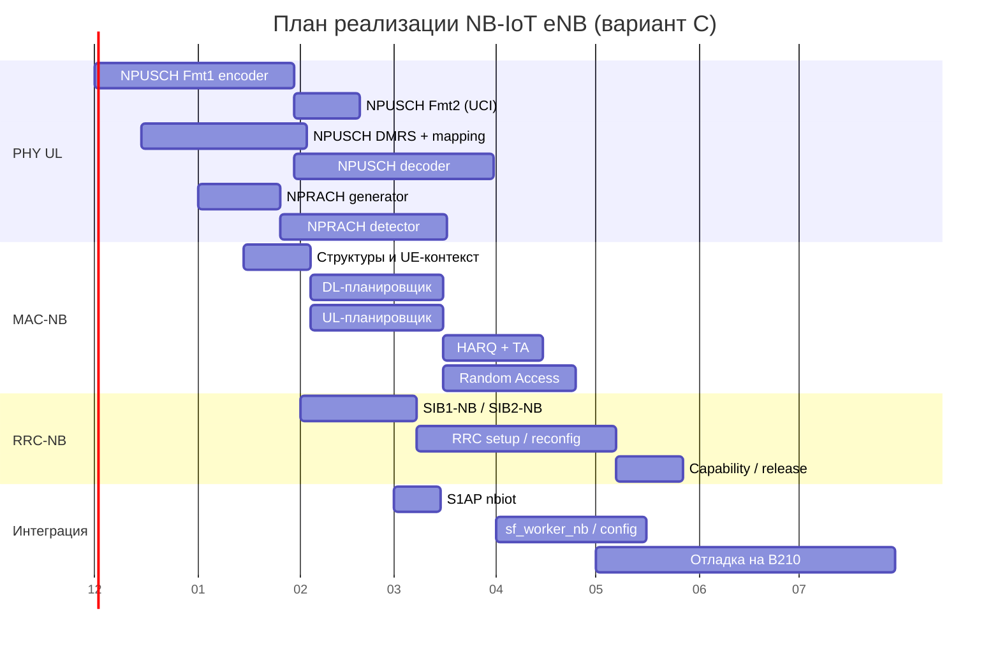

# Дизайн-документ: NB-IoT-стенд для модуля связи L651G

**Дата:** 2026-11-18
**Статус:** предпроектный анализ (feasibility + design)
**Связанные документы:** `AGENTS.md`, `srs-readme.md`, `TRACKING_HANDOVER_OPEN5GS.md`,
`experiment/stand/intsis/README_INTSTS.md`

**Исходные данные:**

- ТЗ-источник: `C:\Users\shmac\Downloads\Модуль связи L651G.pdf`
  (Shanghai Mobiletek, L651 Hardware Design V1.0, 2018-11-23, 41 стр.)
- Целевая платформа: существующий стенд srsRAN_4G (pi5-2 + Base5, Open5GS 2.7.2)

---

## 1. Резюме для руководства

Задача — подключить модуль связи **L651G** (NB-IoT + GSM/GPRS + GNSS) к учебному стенду
как полноценного абонента. Действующий стенд построен на **LTE (E-UTRAN) + Open5GS EPC**,
а модуль работает по **NB-IoT** — это разные радиотехнологии, поэтому подключить его
«как есть» невозможно.

Проведён анализ четырёх путей решения. **Ключевой вывод: ни один свободный программный
стек не готов к применению «из коробки»**:

| Путь | Готовность | Оценка трудозатрат | Вердикт |
|------|-----------|--------------------|---------|
| A. srsRAN Project (`srsgnb`) | нет (заглушка, PHY отсутствует) | — | **исключить** |
| B. OpenAirInterface (Duranta) | код есть, но выключен из сборки | 40–60 недель | не рекомендуется |
| C. Доработка текущего форка | **DL готов, UL отсутствует** | 6–10 месяцев | рекомендуется (свободное ПО) |
| D. Amarisoft (коммерческий) | работает | часы–дни | **рекомендуется (если есть бюджет)** |

Параллельно существует путь **E** — проверка самого модуля без NB-IoT-стенда
(AT-команды + SIM оператора), занимающий 1 день и не требующий разработки.

---

## 2. Анализ исходных данных

### 2.1 Параметры модуля L651G (из PDF)

| Параметр | Значение | Стр. |
|----------|----------|------|
| Тип | NB-IoT + GSM/GPRS + GNSS, LCC 52-pin | 7 |
| Габариты | 24 × 20 × 2.4 мм | 7 |
| Питание VBAT | 3.4–4.2 В (тип. 3.8 В) | 7 |
| Пиковый ток | GSM до **2.0 А**, NB-IoT до **1 А** | 15 |
| Уровни UART/GPIO | **1.8 В** (VIO28 в таблице — опечатка/несогласованность) | 19–20 |
| NB-IoT полосы | **Band 3, Band 5, Band 8** | 6 |
| NB-IoT мощность | 23 dBm ±2 dB | 6 |
| NB-IoT чувствительность | **TBD** (не указана) | 27 |
| Ширина NB-IoT канала | 200 кГц (DL и UL) | 28 |
| Режимы NB-IoT | In-band, guard-band, standalone; PSM, eDRX | 28 |
| Режимы UL | single-tone и multi-tone | 28 |
| Оптимизации | CP-CIoT, UP-CIoT | 28 |
| GSM полосы | GSM850/900, DCS1800, PCS1900 | 26 |
| GPRS | Class 12 | 28 |
| GNSS | GPS + BeiDou (+ Glonass), 64 канала, NMEA/PMTK, 10 Гц | 30–32 |
| SIM | 1.8 В / 3 В / eSIM (встроенная, взаимоисключающая) | 18 |
| Интерфейсы | ADC, IIC, GPIO, SPI(slave), SIM, 3×UART, USB | 7 |
| UART2 (AT) | до 57600 бит/с | 19 |
| HST_UART (debug) | 921600 бит/с | 19 |
| Температура | −40…+85 °C | 21 |

**Важно:** NB-IoT Band 3 модуля = DL 1805–1880 МГц / UL 1710–1785 МГц. Это
**пересекается по частоте** с LTE Band 3 существующих БС стенда (1811 и 1815 МГц),
но это **не та же самая технология**: NB-IoT занимает 180 кГц внутри полосы, а не
6 PRB (1.08 МГц) LTE.

### 2.2 Параметры действующего стенда

| Компонент | Значение | Источник |
|-----------|----------|----------|
| Ядро | Open5GS v2.7.2 (EPC, LTE S1) | `open5gs/docker-compose.yml` |
| PLMN | 250/63 | `open5gs/config/mme.yaml` |
| TAC | 7 (0x0007) | там же |
| APN / DNN | IS2026.net | `open5gs/config/smf.yaml` |
| Абонентская подсеть | 10.0.0.0/24, шлюз 10.0.0.1 | `smf.yaml` |
| MME S1AP | SCTP 36412 на 192.168.1.26 | `mme.yaml` |
| GTP-U | UDP 2152 | `open5gs/docker-compose.yml` |
| БС1 (Base5) | EARFCN 1300 = 1815 МГц, PCI 1, eNB id 0x19B, 6 PRB | `srsran_configs/prod/enb1` |
| БС2 (pi5-2) | EARFCN 1260 = 1811 МГц, PCI 5, eNB id 0x19F, 6 PRB | `srsran_configs/prod/enb5/usb2901` |
| SDR | USRP B210 (БС2), LibreSDR B220mini (БС1) | `AGENTS.md` |
| Железо | Raspberry Pi 5, ARM64 | `AGENTS.md` |

### 2.3 Принципиальное несовпадение

| Уровень | Стенд (LTE) | L651G (NB-IoT) | Совместимость |
|---------|-------------|----------------|---------------|
| Синхронизация | PSS/SSS | **NPSS/NSSS** | ✗ |
| Broadcast | PBCH / MIB | **NPBCH / MIB-NB** | ✗ |
| SIB | SIB1/2 (RRC) | **SIB1-NB/2-NB (RRC-NB)** | ✗ |
| Control | PDCCH (DCI 0/1) | **NPDCCH (DCI N0/N1/N2)** | ✗ |
| Shared DL | PDSCH | **NPDSCH** | ✗ |
| Random access | PRACH | **NPRACH** | ✗ |
| Shared UL | PUSCH | **NPUSCH** | ✗ |
| Ширина канала | 1.4 МГц (6 PRB) | **200 кГц (1 PRB)** | ✗ |
| Ядро | EPC, S1AP RAT-Type=EUTRAN | требует **RAT-Type=nbiot** | частично |

Совпадают только: PLMN (250/63), TAC (7), APN (IS2026.net) — то есть **уровень
идентификаторов сети**, а не радиодоступа.

---

## 3. Обзор вариантов реализации

### 3.1 Вариант A — srsRAN Project (`srsgnb`)

**Проверено в репозитории:**

- `srsgnb/` содержит **113 файлов**: `stack/mac`, `stack/rrc`, `stack/ngap`,
  `stack/ric`, `stack/sdap`.
- Каталог **`srsgnb/src/phy` отсутствует** — PHY-реализации NR нет.
- В `srsgnb/CMakeLists.txt` **нет `add_executable`** — исполняемый файл не
  собирается; `srsenb/src/CMakeLists.txt` подключает `srsgnb_stack` как библиотеку
  к `srsenb`.
- Апстрим `srsran/srsRAN_Project` **архивирован** (README: переход в OCUDU,
  `gitlab.com/ocudu/ocudu`). NB-IoT не поддерживался никогда.

**Вывод: путь неприменим.** Требовал бы написания NB-IoT PHY с нуля.

### 3.2 Вариант B — OpenAirInterface (Duranta / OAI)

**Что есть (проверено поиском по коду):**

- `openair1/PHY/defs_L1_NB_IoT.h`, `impl_defs_lte_NB_IoT.h`, `impl_defs_top_NB_IoT.h`
- `openair1/PHY/LTE_TRANSPORT/defs_NB_IoT.h`, `proto_NB_IoT.h`, `dci_NB_IoT.h`
- `openair1/PHY/CODING/defs_NB_IoT.h` (`ccode_encode_npdsch_NB_IoT`)
- `openair2/LAYER2/MAC/proto_NB_IoT.h` (`schedule_DL_NB_IoT`, `check_resource_NPDSCH_NB_IoT`)
- `openair2/LAYER2/MAC/defs_NB_IoT.h` (`NPDCCH`, `NPUSCH`, `NPDSCH`)
- `openair2/RRC/LTE/rrc_types_NB_IoT.h`, `proto_NB_IoT.h`, `defs_NB_IoT.h`
- `openair2/RRC/LTE/MESSAGES/asn1_msg_NB_IoT.c` (`do_MIB_NB_IoT`, SIB1-NB, SIB2-NB)

**Что не так:**

1. **Не заявлено в `doc/FEATURE_SET.md`** — официально поддерживается только
   LTE-M `CE-modeA` («Limited support for repetition, single-LTE-M connection»).
2. **Не включено в сборку.** В корневом `CMakeLists.txt` из NB-IoT фигурирует
   **единственный файл** — `asn1_msg_NB_IoT.c` в составе библиотеки `lte_rrc`.
   Target'ов `NB_IoT` MAC/PHY нет. `lte-softmodem` линкует только
   `openair2/ENB_APP/NB_IoT_interface.c` (заглушка интерфейса).
3. **Issues по «NB-IoT» в `duranta-project/openairinterface5g` — 0 результатов.**
4. **Платформа:** `doc/system_requirements.md` — поддерживаются `x86_64` (AVX2) и
   `aarch64` (Neoverse-N1/N2, Grace Hopper). **Cortex-A76 (Raspberry Pi 5) в списке нет.**
5. Код датируется 2018–2019, без CI и без интеграционных тестов.

**Оценка: 40–60 инженерных недель** (реанимация + сборка + отладка + S1AP NB-IoT).

### 3.3 Вариант C — доработка текущего форка srsRAN_4G ⭐

**Главная находка: NB-IoT downlink в форке уже реализован.**

Состав `lib/` (проверено, размеры в строках):

| Файл | Строк | Что реализовано |
|------|-------|-----------------|
| `lib/src/phy/phch/npbch.c` | 547 | NPBCH encode/decode, MIB-NB pack/unpack, CRC mask |
| `lib/src/phy/phch/npdcch.c` | 699 | NPDCCH encode/decode, DCI N1/N2, conv coding, `npdcch_put/get` |
| `lib/src/phy/phch/npdsch.c` | 721 | NPDSCH encode/decode, SIB1-NB pack/unpack, scrambling |
| `lib/src/phy/phch/ra_nbiot.c` | 485 | DL/UL grants, TBS, SIB1 scheduling, `delta_f` |
| `lib/src/phy/phch/dci_nbiot.c` | 388 | DCI pack/unpack, RAR grant unpack, RAR→UL grant |
| `lib/src/phy/sync/sync_nbiot.c` | 301 | NPSS/NSSS synchronization |
| `lib/src/phy/ch_estimation/chest_dl_nbiot.c` | 304 | Channel estimation DL |
| `lib/src/phy/ch_estimation/refsignal_dl_nbiot.c` | 248 | NRS generation |
| `lib/src/phy/ue/ue_dl_nbiot.c` | 932 | UE DL processor |
| `lib/src/phy/ue/ue_mib_nbiot.c` | 240 | MIB-NB decoder |
| `lib/src/phy/ue/ue_sync_nbiot.c` | 575 | UE sync |
| `lib/src/phy/ue/ue_cell_search_nbiot.c` | 142 | Cell search |
| `lib/src/asn1/rrc_nbiot.cc` | ~21 000 | Полный RRC-NB ASN.1 (генер.) |
| `lib/examples/npdsch_enodeb.c` | 651 | **DL-only NB-IoT eNB (демо)** |
| `lib/examples/npdsch_ue.c` | 963 | NB-IoT UE (DL) |

CHANGELOG подтверждает: `19.09` — «Add sync code for NB-IoT»; `20.04` — «**Complete
NB-IoT PHY downlink signals**».

**Публичный API (фактически существующий):**

```c
/* NPBCH — lib/include/srsran/phy/phch/npbch.h */
int  srsran_npbch_init(srsran_npbch_t*);
void srsran_npbch_mib_pack(uint32_t hfn, uint32_t sfn, srsran_mib_nb_t, uint8_t*);
int  srsran_npbch_put_subframe(...);
int  srsran_npbch_encode(...);

/* NPDCCH — lib/include/srsran/phy/phch/npdcch.h */
int  srsran_npdcch_encode(...);
int  srsran_npdcch_decode_msg(...);
int  srsran_npdcch_put(...);
int  srsran_npdcch_get(...);

/* NPDSCH — lib/include/srsran/phy/phch/npdsch.h */
int  srsran_npdsch_cfg(...);
int  srsran_npdsch_encode(...);
int  srsran_npdsch_encode_rnti(...);
int  srsran_npdsch_decode(...);
void srsran_npdsch_sib1_pack/unpack(...);

/* Resource allocation — lib/include/srsran/phy/phch/ra_nbiot.h */
int  srsran_ra_nbiot_dl_dci_to_grant(...);
int  srsran_ra_nbiot_ul_dci_to_grant(...);
int  srsran_ra_nbiot_ul_rar_dci_to_grant(...);
int  srsran_ra_nbiot_get_npdsch_tbs(uint32_t i_tbs, uint32_t i_sf);
int  srsran_ra_nbiot_get_npusch_tbs(uint32_t i_tbs, uint32_t i_ru);   /* есть! */
void srsran_ra_nbiot_ul_grant_to_nbits(...);
float srsran_ra_nbiot_get_delta_f(srsran_npusch_sc_spacing_t);

/* DCI — lib/include/srsran/phy/phch/dci_nbiot.h */
int  srsran_nbiot_dci_msg_to_dl_grant(...);
int  srsran_nbiot_dci_msg_to_ul_grant(...);
int  srsran_dci_msg_pack_npdsch(...);
int  srsran_dci_msg_unpack_npusch(...);
```

**Что ОТСУТСТВУЕТ (проверено grep'ом — 0 совпадений):**

| Отсутствует | Комментарий |
|-------------|-------------|
| `srsran_npusch_*` (любые функции) | **нет ни одного символа** — только UL-гранты |
| `srsran_nprach_*` | нет вообще |
| `nulsch` / `npusch_put` / `npusch_dmrs` | нет |
| MAC-NB (`mac_nb`, `sched_nb`, `ue_nb`) | нет |
| RRC-NB логика (`rrc_nb_ue`, `rrc_nb_cell`) | нет (есть только ASN.1) |
| S1AP NB-IoT | `RAT-Type nbiot` есть в enum (`lib/include/srsran/asn1/s1ap.h:2452`), но `srsenb/src/stack/s1ap/s1ap.cc` хардкодит EUTRAN |
| Код NB-IoT в `srsenb/` | grep = **0 совпадений** |

**Ключевое ограничение:** в `lib/examples/npdsch_enodeb.c` переменная
`#define HAVE_NPDSCH 1` управляет только DL; UL-веток нет. Демо передаёт
**только DL-сигналы** (NPBCH/NPSS/NSSS/NRS/NPDCCH/NPDSCH) с
`SRSRAN_NBIOT_MODE_STANDALONE`, `nof_prb = SRSRAN_NBIOT_DEFAULT_NUM_PRB_BASECELL (1)`,
`nbiot_prb = SRSRAN_NBIOT_DEFAULT_PRB_OFFSET (0)`.

Поддерживаемые режимы (`lib/include/srsran/phy/common/phy_common.h:337`):
`INBAND_SAME_PCI`, `INBAND_DIFFERENT_PCI`, `GUARDBAND`, `STANDALONE`.

### 3.4 Вариант D — Amarisoft

Коммерческий NB-IoT eNB (Amarisoft LTE/5G). Готовое решение, поддерживает NB-IoT
in-band/guard-band/standalone, работает с Open5GS как EPC. **Требует лицензии**
(стоимость — вне рамок этого документа). Развёртывание — конфигурация + отладка
радиоинтерфейса, **часы–дни**, не месяцы.

---

## 4. Детальный дизайн варианта C

### 4.1 Целевая архитектура

```text
┌─────────────────────────────────────────────────────────────────────┐
│  pi5-2 (192.168.1.26, Raspberry Pi 5, ARM64)                        │
│                                                                     │
│  ┌──────────────┐   S1-MME (SCTP 36412)   ┌──────────────────────┐  │
│  │  Open5GS     │◄────────────────────────┤  srsenb-nb           │  │
│  │  2.7.2       │                         │  (новый процесс)     │  │
│  │  MME/HSS/    │   GTP-U (UDP 2152)      │                      │  │
│  │  SGW/PGW     │◄────────────────────────┤  MAC-NB (новый)      │  │
│  │              │                         │  RRC-NB (новый)      │  │
│  │  PLMN 250/63 │                         │  PDCP/RLC (reuse)    │  │
│  │  TAC 7       │                         │  PHY-NB DL (есть)    │  │
│  │  APN IS2026  │                         │  PHY-NB UL (новый)   │  │
│  └──────┬───────┘                         └──────────┬───────────┘  │
│         │ ogstun 10.0.0.1/24                         │ UHD          │
│         │                                            │              │
│    NAT/FORWARD                                 ┌─────┴──────┐       │
│    (start-core.sh)                             │ USRP B210  │       │
│                                                │ NB-IoT ANT │       │
│                                                └─────┬──────┘       │
└──────────────────────────────────────────────────────┼──────────────┘
                                                       │ 180 кГц
                                                  ┌────┴─────┐
                                                  │  L651G   │
                                                  │  (UE)    │
                                                  └──────────┘
```

**Вариант развёртывания:** отдельный процесс `srsenb-nb` **на той же pi5-2**, но с
**отдельным SDR-каналом** (второй B210 или отдельный TX/RX-тракт). Существующие
LTE-БС продолжают работать независимо.

### 4.2 Радиопланирование

| Параметр | Значение | Обоснование |
|----------|----------|-------------|
| Технология | NB-IoT Release 13 | L651G — Rel-13 |
| Режим развёртывания | **Standalone** (рекомендуется) или **In-band** | Standalone проще: нет LTE-несущей рядом |
| Band | **Band 3** (1805–1880 МГц DL / 1710–1785 МГц UL) | модуль поддерживает только B3/B5/B8; B3 совпадает с LTE Band 3 стенда |
| DL частота (standalone) | напр. **1842.5 МГц** (центр 200 кГц) | свободна от БС1 (1815) и БС2 (1811) |
| UL частота | пара по duplex spacing Band 3 = 95 МГц → **1747.5 МГц** | 3GPP TS 36.101 |
| Ширина | 200 кГц (1 PRB, 12 поднесущих × 15 кГц) | стандарт NB-IoT |
| PCI (NCell ID) | 0–503, напр. **7** | не пересекается с PCI 1 и 5 |
| NRS | 2 порта (2 NRS-символа/слот) | Rel-13 |
| Мощность | 23 dBm (200 мВт) | по спецификации модуля |
| In-band альтернатива | центр 1815 МГц, `nbiot_prb` внутри LTE-полосы | **требует** синхронной работы с LTE-БС — сложнее |

**Standalone предпочтителен**: `npdsch_enodeb.c` уже настроен на
`SRSRAN_NBIOT_MODE_STANDALONE`, `nof_prb = 1`, `nbiot_prb = 0`.

### 4.3 Компоненты, которые нужно реализовать

#### 4.3.1 PHY UL: NPUSCH (самый крупный блок)

**Стандарт:** 3GPP TS 36.211 §10.1, TS 36.212 §5.3.3, TS 36.213 §16.3.

| Подзадача | Содержание | Оценка |
|-----------|-----------|--------|
| NPUSCH Формат 1 (UL-SCH) | turbo coding (reuse `lib/src/phy/fec/turbo`), rate matching, scrambling (gold seq), π/2-BPSK (single-tone) и QPSK (multi-tone) | 2–3 нед. |
| NPUSCH Формат 2 (UCI) | HARQ-ACK, 16 поднесущих, BPSK, RS-схема | 1 нед. |
| DMRS для NPUSCH | base sequence (Zadoff-Chu), cyclic shift, orthogonal sequence по 3GPP 36.211 §10.1.3 | 1 нед. |
| Resource unit mapping | 1 RU = 16 slots (15 кГц) / 8 slots (3.75 кГц); subcarrier allocation из `sc_alloc_set[]` | 1 нед. |
| Frequency hopping | `delta_f` (уже есть `srsran_ra_nbiot_get_delta_f`) | 0.5 нед. |
| Репитиции | `nof_rep` до 128, cross-subframe | 0.5 нед. |
| **Декодер (RX)** | demodulation, descrambling, rate de-matching, turbo decode, CRC | 2–3 нед. |

**Итого NPUSCH: 8–10 недель.**

API-образец (по аналогии с `npdsch.h`):

```c
typedef struct {
  srsran_nbiot_cell_t cell;
  /* buffers: llr, d, data, symbols, dft */
} srsran_npusch_t;

int  srsran_npusch_init(srsran_npusch_t* q);
int  srsran_npusch_set_cell(srsran_npusch_t* q, srsran_nbiot_cell_t cell);
int  srsran_npusch_encode(srsran_npusch_t* q, srsran_ra_nbiot_ul_grant_t* grant,
                          uint8_t* data, cf_t* sf_symbols);
int  srsran_npusch_decode(srsran_npusch_t* q, srsran_ra_nbiot_ul_grant_t* grant,
                          cf_t* sf_symbols, uint8_t* data);
```

#### 4.3.2 PHY UL: NPRACH

**Стандарт:** TS 36.211 §10.1.6, TS 36.321 §5.1.

| Подзадача | Содержание | Оценка |
|-----------|-----------|--------|
| Генератор преамбулы | 4 symbol groups × 5 символов, 3.75 кГц spacing, single-tone | 1 нед. |
| Hop-паттерн | frequency hopping по 4 группам, псевдослучайный по `NCell ID` | 1 нед. |
| Детектор | корреляция по 12/24/36/48 поднесущим, 3 CE-уровня | 2–3 нед. |
| CE-level (0/1/2) | пороги, `nprach_Config` | 1 нед. |

**Итого NPRACH: 4–6 недель.**

#### 4.3.3 MAC-NB

**Стандарт:** TS 36.321.

| Подзадача | Содержание | Оценка |
|-----------|-----------|--------|
| Структуры | `ue_nb`, `sched_nb_ue`, буферы LCH | 1 нед. |
| DL-планировщик | NPDCCH candidates (2 формата), NPDSCH allocation, DCI N1/N2 | 2 нед. |
| UL-планировщик | NPUSCH RU allocation, DCI N0, SR | 2 нед. |
| HARQ | асинхронный UL (4 процесса), синхронный DL | 1.5 нед. |
| Random Access | Msg1 (NPRACH) → RAR → Msg3 → contention resolution | 2 нед. |
| Timing Advance | TA command в RAR и в MAC CE | 1 нед. |
| BSR / PHR / DRX (eDRX) | опционально для Rel-13 | 1.5 нед. |

**Итого MAC-NB: 9–11 недель.**

#### 4.3.4 RRC-NB

**Стандарт:** TS 36.331 (главы NB-IoT).

| Подзадача | Содержание | Оценка |
|-----------|-----------|--------|
| MIB-NB / SIB1-NB | schedulingInfoSIB1, TBS, repetition — **API есть** (`srsran_npdsch_sib1_pack`) | 1 нед. |
| SIB2-NB | `radioResourceConfigCommon`, NPRACH/NPDSCH/NPUSCH config | 1.5 нед. |
| SIB3/4/5-NB | cell reselection | 1 нед. |
| RRC connection setup | SRB0/SRB1, `rrcConnectionSetup-NB` | 1.5 нед. |
| RRC reconfiguration | DRB setup, `radioResourceConfigDedicated-NB` | 1.5 нед. |
| UE capability / release | `UE-Capability-NB`, `rrcConnectionRelease-NB` | 1 нед. |
| Paging | PCCH-NB | 1 нед. |

**Итого RRC-NB: 7–9 недель.**

#### 4.3.5 S1AP NB-IoT

| Подзадача | Содержание | Оценка |
|-----------|-----------|--------|
| RAT-Type = nbiot | `s1ap.cc:401` — параметризовать `eutran_cgi` / RAT | 0.5 нед. |
| `NB-IoT-DefaultPagingDRX` | IE в S1SetupRequest | 0.5 нед. |
| UE Category NB1 | в Initial UE Message | 0.5 нед. |
| Open5GS: `mme.yaml` | добавить NB-IoT-настройки, проверить HSS | 0.5 нед. |

**Итого S1AP: 2 недели.**

#### 4.3.6 Интеграция в `srsenb`

| Подзадача | Содержание | Оценка |
|-----------|-----------|--------|
| `sf_worker_nb` | аналог `srsenb/src/phy/lte/sf_worker.cc`, но NB-IoT SF (1 мс) | 2 нед. |
| `cc_worker_nb` / `worker_pool` | NB-IoT carrier в пуле | 1 нед. |
| Конфиг `enb-nb.conf` | новый парсер-раздел `nb_iot {}` | 1 нед. |
| Метрики / логи | `metrics_stdout` для NB-IoT | 1 нед. |
| Сборка/линковка | CMake, ARM64 | 1 нед. |
| **Отладка на B210** | CFO, тайминги, уровень мощности | **3–5 нед.** |

**Итого интеграция: 9–11 недель.**

### 4.4 Сводная оценка

| Блок | Недель |
|------|--------|
| NPUSCH | 8–10 |
| NPRACH | 4–6 |
| MAC-NB | 9–11 |
| RRC-NB | 7–9 |
| S1AP NB-IoT | 2 |
| Интеграция + отладка | 9–11 |
| **Итого** | **39–49 недель** (≈ 9–11 месяцев) |

С учётом рисков и итераций отладки на железе — **10–12 месяцев** для одного
инженера. Кодовому агенту это соответствует **~6–10 месяцев** календарной работы
при условии регулярной проверки на реальном SDR (агент не может «услышать» эфир).

### 4.5 Порядок работ (roadmap)



**Этапы (вехи):**

| Веха | Критерий готовности | Ориентир |
|------|---------------------|----------|
| M1 | NB-IoT DL (уже есть) передаётся с B210; `npdsch_ue` декодирует MIB-NB и SIB1-NB | готово (демо) |
| M2 | NPUSCH encoder/decoder проходит unit-тест против эталонных векторов 36.212 | +3 мес. |
| M3 | NPRACH детектируется; Msg1 → RAR работает | +5 мес. |
| M4 | Msg3/Msg4 — RRC connection setup завершается | +7 мес. |
| M5 | **L651G attach** → Open5GS выдаёт IP из 10.0.0.0/24 | +9 мес. |
| M6 | ICMP/ping до 10.0.0.1, доступ к `http://10.0.0.1:8080` | +10 мес. |

### 4.6 Точки интеграции с существующей инфраструктурой

**Ядро (Open5GS):**

```
open5gs/config/mme.yaml     → NB-IoT-DefaultPagingDRX, RAT-Type=nbiot
open5gs/config/hss.yaml     → без изменений (db_uri mongodb)
open5gs/config/smf.yaml     → APN IS2026.net уже есть; проверить session subnet
open5gs/config/upf.yaml     → 10.0.0.0/24 (уже)
```

**Скрипты стенда (`experiment/stand/intsis/pi5-2/`):**

- добавить `start-bs-nb.sh` / `stop-bs-nb.sh` по образцу `start-bs.sh`;
- включить в `start-all.sh` / `stop-all.sh` / `status.sh`;
- обновить `README_INTSTS.md`.

**Дашборд (`srsran-dashboard/`):**

- добавить контейнер `enb-nb` в список управляемых (`docker` API);
- лог-стрим через существующий SSE.

**Аппаратная часть:**

| Компонент | Требование |
|-----------|-----------|
| SDR | USRP B210 (уже есть) — NB-IoT 200 кГц, `master_clock_rate` кратен 192 кГц |
| Антенна | 1842 МГц, 50 Ом; при standalone — отдельная от LTE-БС |
| Модуль L651G | питание 3.8 В / **≥2 А**, тантал ≥470 мкФ; **UART 1.8 В → level shifter** к 3.3 В |
| SIM | USIM 1.8/3 В, записать IMSI из `user_db` Open5GS |
| GNSS (опц.) | активная антенна на GNSS_ANT |

### 4.7 Риски

| Риск | Вероятность | Влияние | Митигация |
|------|-------------|---------|-----------|
| Pi 5 не тянет NB-IoT PHY в реальном времени | средняя | высокое | сначала отладка на x86 ПК с B210, потом перенос |
| USRP B210: CFO/тайминг для 200 кГц | высокая | высокое | использовать `master_clock_rate = 1.92 МГц`, тесты в loopback |
| Модуль не регистрируется в standalone Band 3 | средняя | высокое | проверить `AT+COPS=?`, `AT+CEREG?`; возможно требуется in-band |
| Чувствительность L651G = TBD в PDF | высокая | среднее | измерить `AT+CSQ`/`AT+NUESTATS`; при плохом уровне — уменьшить расстояние |
| Регрессия существующего LTE-стенда | низкая | высокое | отдельный процесс, отдельная частота, отдельный контейнер |
| Объём работ недооценён | высокая | высокое | вехи M2–M6 с проверкой; возможность остановиться на M2 (DL-демо) |

### 4.8 Критерии приёмки

1. `srsenb-nb` запускается, передаёт NPBCH/NPSS/NSSS/NRS/NPDCCH/NPDSCH.
2. `lib/examples/npdsch_ue` на втором SDR декодирует MIB-NB и SIB1-NB
   (**проверяемо уже сегодня**).
3. L651G видит соту: `AT+COPS=?` показывает PLMN 250/63.
4. L651G регистрируется: `AT+CEREG?` → `0,1` или `0,5`.
5. L651G attach: в логе Open5GS `Attach request` и выдача IP из 10.0.0.0/24.
6. `ping 10.0.0.1` с модуля проходит.
7. `http://10.0.0.1:8080` доступен с модуля (проверка пользовательской плоскости).

---

## 5. Вариант E — проверка модуля без NB-IoT-стенда

Если цель — **убедиться, что модуль рабочий**, а не строить стенд.

**Схема:** L651G → (VBAT 3.8 В/2 А, level shifter 1.8↔3.3 В) → UART → ПК/Pi.

**AT-команды:**

```
AT                                  # отклик OK — модуль жив
ATI                                 # версия прошивки
AT+CPIN?                            # READY — SIM распознана
AT+CSQ                              # уровень сигнала
AT+COPS=?                           # список доступных PLMN
AT+CGDCONT=1,"IP","<APN>"           # контекст
AT+CGATT=1                          # attach к сети
AT+CEREG?                           # состояние регистрации
AT+NUESTATS                         # статистика NB-IoT (RSRP/SNR)
AT+CGSN                             # IMEI
```

**Продолжительность:** 1 день. Требуется SIM оператора с NB-IoT-профилем.

---

## 6. Рекомендации

1. **Если цель — реальный абонент на стенде и есть бюджет** → **вариант D (Amarisoft)**.
   Часы–дни вместо месяцев; совместим с текущим Open5GS.
2. **Если бюджет только свободное ПО** → **вариант C** (доработка форка).
   Главный плюс — **NB-IoT DL уже написан**, что экономит ~25 % объёма.
   Реалистично — 10–12 месяцев с отладкой на железе.
3. **Если нужно только проверить модуль** → **вариант E**, 1 день.
4. **Варианты A и B — исключить.** A неприменим (нет PHY, проект закрыт),
   B требует реанимации кода без тестов и CI.

**Промежуточная рекомендация:** начать с вехи **M1** — запустить существующий
`npdsch_enodeb` на B210 и принять сигнал вторым SDR через `npdsch_ue`. Это
проверяет тракт SDR и готовность DL **за дни**, до любых крупных вложений.

---

## 7. Приложения

### A. Ссылки на спецификации

| Документ | Содержание |
|----------|-----------|
| 3GPP TS 36.211 | Physical channels and modulation (NPSS, NSSS, NPBCH, NPDCCH, NPDSCH, NPUSCH, NPRACH) |
| 3GPP TS 36.212 | Multiplexing and channel coding (NB-IoT DL-SCH/UL-SCH) |
| 3GPP TS 36.213 | Physical layer procedures (§16 — NB-IoT) |
| 3GPP TS 36.321 | MAC protocol (§5.1 — Random Access для NB-IoT) |
| 3GPP TS 36.331 | RRC (MIB-NB, SIB1/2/3/4/5-NB, RRC-NB) |
| 3GPP TS 36.101 | UE radio transmission and reception (Band 3 duplex spacing) |
| 3GPP TS 36.413 | S1AP (RAT-Type nbiot) |

### B. Файлы репозитория, использованные при анализе

| Файл | Что проверено |
|------|---------------|
| `lib/src/phy/phch/{npbch,npdcch,npdsch,ra_nbiot,dci_nbiot}.c` | наличие DL PHY |
| `lib/include/srsran/phy/phch/{npbch,npdcch,npdsch,ra_nbiot,dci_nbiot}.h` | публичный API |
| `lib/src/phy/{sync,ch_estimation,ue}/*nbiot*` | синхра, оценка канала, UE |
| `lib/src/asn1/rrc_nbiot.cc` | RRC-NB ASN.1 |
| `lib/examples/{npdsch_enodeb,npdsch_ue}.c` | демо DL |
| `lib/include/srsran/phy/common/phy_common.h:337` | режимы NB-IoT |
| `lib/include/srsran/asn1/s1ap.h:2452` | `RAT-Type nbiot` (только enum) |
| `srsenb/src/stack/s1ap/s1ap.cc` | хардкод EUTRAN |
| `srsgnb/` (113 файлов) | отсутствие PHY |
| `srsenb/src/phy/lte/sf_worker.cc` | образец для `sf_worker_nb` |
| `open5gs/config/*.yaml` | PLMN, TAC, APN |
| `srsran_configs/prod/readme.md` | EARFCN БС |
| `CHANGELOG` (19.09, 20.04) | история NB-IoT DL |

### C. Внешние источники

| Источник | Факт |
|----------|------|
| `github.com/srsran/srsRAN_Project` | архивирован, переход в OCUDU (`gitlab.com/ocudu/ocudu`) |
| `duranta-project/openairinterface5g` `doc/FEATURE_SET.md` | NB-IoT не заявлен (только LTE-M CE-modeA) |
| `duranta-project/openairinterface5g` `CMakeLists.txt` | NB-IoT в сборке: только `asn1_msg_NB_IoT.c` |
| `duranta-project/openairinterface5g` issues | 0 результатов по «NB-IoT» |
| `doc/system_requirements.md` | x86_64 AVX2 / aarch64 Neoverse-N1/N2 |

---

**Дата подготовки:** 2026-11-18
**Автор анализа:** кодовый агент (GitHub Copilot)
